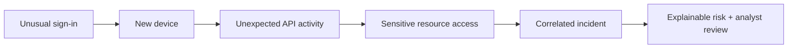
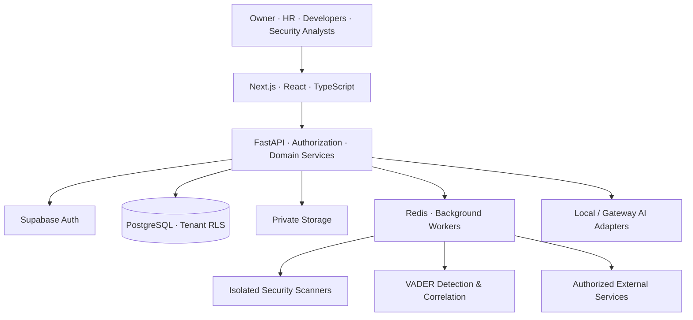

# ◈ MESH

### One workspace. Four powerful systems. Connected intelligence.

**An AI-assisted enterprise operating system for people, projects, business operations, and cybersecurity.**

  
  
  

  
  
  
  
  
  

**[Explore the platform](#-meet-the-mesh-ecosystem)** · **[Architecture](#-system-architecture)** · **[Getting started](#-getting-started)** · **[Roadmap](#-roadmap)**

---

## ✦ The idea

Modern organizations run on disconnected systems: one for employees, another for engineering, another for budgets, and yet another for security. **MESH brings those workflows into one connected platform**—with role-aware experiences, shared operational context, and explainable AI-assisted insights.

> **MESH = Management + Engineering + Security + Human resources.** A unified product vision, developed as a modular full-stack engineering project.

| ◈ Owner | ◈ People | ◈ DevTrack | ◈ VADER |
|:--:|:--:|:--:|:--:|
| Business intelligence | Human resources | Engineering operations | Security intelligence |

### Designed around real engineering challenges

- **Isolation by default** — tenant-aware data access, resource-scoped permissions, and PostgreSQL Row Level Security.
- **Human-in-the-loop decisions** — approvals for sensitive HR, organizational, and security operations.
- **Security-first development** — authorized repository scanning, sanitized findings, and controlled external integrations.
- **Explainable intelligence** — transparent risk evidence and assumption-aware AI-assisted analysis.
- **Built to evolve** — modular backend services and a frontend API layer intended for integration.

---

## ✦ Meet the MESH ecosystem

### 01 / MESH Owner — The organization command center

Business dashboards, project approvals, financial budgets, cost trends, performance insights, and AI-assisted what-if scenarios.

**Highlights:** Operational KPIs · Budget tracking · Project approvals · Organization administration · What-If Studio

### 02 / MESH People — A connected employee lifecycle

Employee profiles, HR invitations, private identity review, complaints, leave, compensation workflows, and controlled onboarding/offboarding.

**Highlights:** Employee directory · Confidential investigations · Payroll snapshots · Leave approvals · Lifecycle workflows

### 03 / MESH DevTrack — Engineering meets secure delivery

Project proposals, tasks, Kanban boards, sprints, approvals, and findings from authorized repository analysis.

**Highlights:** Developer workspaces · Sprint management · Semgrep / Bandit / Gitleaks / OSV · Findings history · Trust Stars

### 04 / MESH VADER — See the signals. Connect the evidence.

Security telemetry, behavioral anomalies, incident correlation, explainable risk assessments, and AI-assisted investigation.

**Highlights:** Security command center · Behavioral baselines · Attack-chain visualization · Incident investigation · Simulation lab

### A closer look at VADER

Rather than treating each alert as an isolated event, VADER is designed to connect related evidence into a coherent incident:



*Illustrative event sequence. Detection depends on authorized telemetry, configured rules, and available evidence; a risk score is not proof of compromise.*

---

## ✦ System architecture



**Architecture status:** This diagram represents the intended integrated platform. The frontend and backend are implemented separately; connecting them and validating complete user journeys are ongoing tasks.

### Engineering decisions and security boundaries

| Concern | Approach |
|---|---|
| Tenant isolation | Organization-scoped authorization plus PostgreSQL RLS |
| Authentication | Supabase Auth integration, JWT verification, MFA workflows |
| Long-running work | Redis-backed coordination and background jobs |
| Repository analysis | Restricted, authorized scanning with redacted findings |
| Security monitoring | Rule/statistical signals, correlation, explainable risk |
| Sensitive HR workflows | Independent reviews and retained activity history |
| External services | Explicit configuration, least privilege, verified outcomes |
| AI | Structured outputs, limited context, tracked usage |

**Important:** Frontend role switching is a demonstration feature, not an authorization boundary. Backend authorization and tenant controls must be independently enforced.

---

## ✦ Technology stack

| Layer | Technologies |
|:--|:--|
| **Frontend** | Next.js, React, TypeScript, Tailwind CSS, TanStack Table, React Flow |
| **Backend** | Python, FastAPI, PostgreSQL, Supabase |
| **Async & infrastructure** | Redis, background workers, Docker, GitHub Actions |
| **Code security** | Semgrep, Bandit, Gitleaks, OSV |
| **AI** | Local/Ollama and configurable model gateway adapters |
| **Testing** | Pytest, Playwright, linting, type checks, integration tests |

---

## ✦ What makes MESH different?

**One platform, multiple perspectives.** Owners see operations and financial trends; HR manages people; developers coordinate work; analysts investigate security signals. Each role sees an experience designed for its responsibilities.

**Engineering + cybersecurity in the same workflow.** DevTrack's repository findings and VADER's event-driven investigations are part of the same product vision, rather than unrelated dashboard demos.

**Decision support, not automatic judgment.** Trust Stars and behavioral risk signals are contextual and reviewable. They are not standalone grounds for adverse employee decisions or access revocation.

**Real security boundaries.** The backend is designed around resource-level authorization, forced tenant RLS, scoped storage access, auditable changes, and controlled scanning—not just hidden frontend links.

---

## ✦ Development snapshot

> [!IMPORTANT]
> **MESH is in active development.** Core frontend screens and substantial backend capabilities exist, but frontend–backend integration, selected external-provider acceptance, full end-to-end testing, and production hardening are not finished. Mock/simulated actions must not be mistaken for live operations.

| Area | Status |
|:--|:--|
| Owner, People, DevTrack, VADER UI foundations | ✅ Built |
| Backend API and tenant database foundation | ✅ Implemented and tested in controlled environments |
| Core authentication, HR, projects, scanning and VADER services | ✅ Substantial backend implementation |
| Frontend workflow completion and API-layer cleanup | 🚧 In progress |
| Frontend ↔ backend integration | ⏳ Pending |
| Real GitHub/cloud/email provider acceptance | 🚧 Partially pending |
| Production security clearance and deployment | ⏳ Pending |

### Backend validation snapshot · 25 October 2026

Reported by the backend development environment:

| Metric | Reported result |
|---|---:|
| OpenAPI operations | 159 |
| Application tables | 51 |
| Supabase schema revision | 0018 |
| Windows tests | 476 passed |
| Linux tests | 483 passed |
| Docker Compose gates | 9 passed |

Windows and Linux test suites overlap. These numbers describe reported checks, not independent production certification. Additional authenticated load testing, provider validation, and security review remain outstanding.

---

## ✦ Getting started

### Frontend

```bash
# From the frontend directory
npm install
npm run dev
```

Open **http://localhost:3000**.

```bash
# Common verification commands
npx tsc --noEmit
npm run lint
npm run build
npx playwright test
```

> Frontend demo data and simulated flows are not live backend operations. Some Playwright tests may require browser installation and additional setup.

### Backend

The backend requires its own Python dependencies, Supabase/PostgreSQL configuration, Redis, Docker, migrations, and environment variables. **Follow the backend's setup documentation** rather than assuming the frontend commands launch the whole system.

**Never commit** `.env` files, API keys, Supabase service-role credentials, GitHub App private keys, or real employee identity documents.

---

## ✦ Roadmap

- [x] Design the MESH ecosystem and shared UI system
- [x] Build core pages across all four modules
- [x] Establish backend services, tenant RLS, and API foundations
- [x] Implement controlled scanner and VADER backend workflows
- [ ] Finish frontend complaints, promotions, organization switching, search, and Trust Stars alignment
- [ ] Consolidate frontend data access behind API adapters
- [ ] Integrate frontend authentication and module APIs with the backend
- [ ] Validate complete end-to-end user journeys
- [ ] Verify real GitHub, email, OCR, and cloud integrations where authorized
- [ ] Complete security remediation, monitoring, backup/recovery, and production readiness review

---

## ✦ Screenshots & demo

**Product screenshots and an end-to-end demo will be added after the integrated application is validated.** This section intentionally avoids using mock screenshots as evidence of live integrations.

---

## ✦ Author

**Advaya Mishra**

*Project creator & developer*

Building MESH as a long-term software engineering project exploring enterprise architecture, full-stack systems, AI-assisted workflows, and defensive cybersecurity.

---

## ✦ License

Distributed under the **MIT License**. See [`LICENSE`](LICENSE) for details.

**Copyright © 2026 Advaya Mishra.**

---

### ◈ MESH

**Connected teams. Informed decisions. Stronger security.**

*Designed and developed by Advaya Mishra · MIT Licensed*

